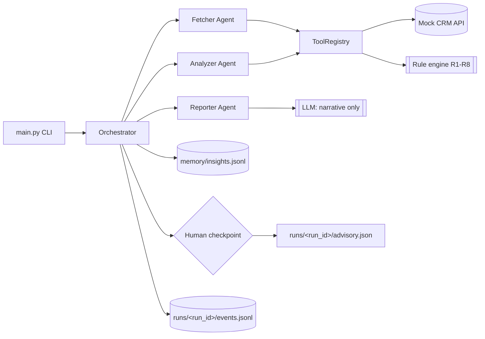

# Architecture

## Sequence for one client

1. `main.py` builds the `ToolRegistry` (CRM tools + analysis tools) and the logger.
2. Orchestrator creates a `RunContext` (short-term memory) and reads the last 3 stored insights.
3. Fetcher: `crm.get_profile` -> `crm.get_transactions` -> `crm.get_notes`. Any failure is written to `degraded_reasons`; the run continues.
4. Analyzer: `analysis.detect_anomalies` (+ trends, risk) over the transactions.
5. Reporter: findings + memories + advisor notes -> summary and recommendations (LLM if configured, otherwise deterministic).
6. Human checkpoint: pauses when a `high` finding exists, unless `--auto-approve`.
7. Output written to `runs/<run_id>/advisory.json`; one line appended to the long-term memory.

## Where the seams are

| Seam | Interface | Why it matters |
|---|---|---|
| Agent <-> outside world | `ToolRegistry` | agents cannot reach `httpx`; tests swap tools for fakes |
| Tool <-> failure | `ToolResult` | a failed call is data the orchestrator can reason about |
| Agent <-> agent | `RunContext` | one shared context object, no globals |
| System <-> reviewer | `advisory.json` + `events.jsonl` | the deliverable is inspectable without reading the code |
